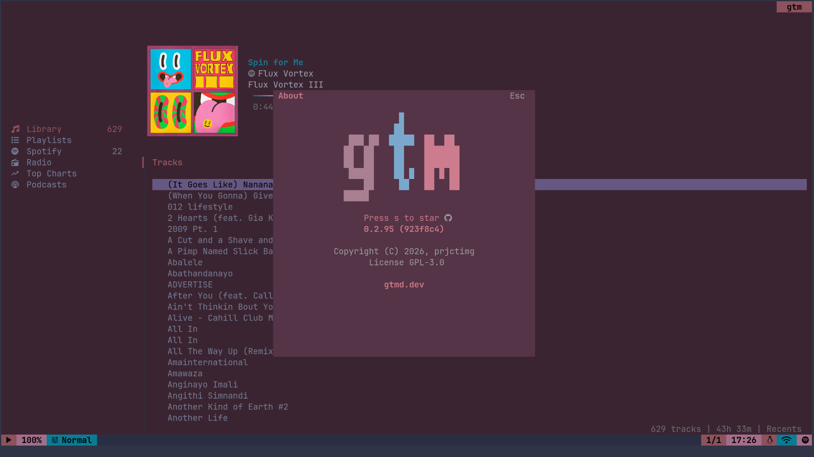
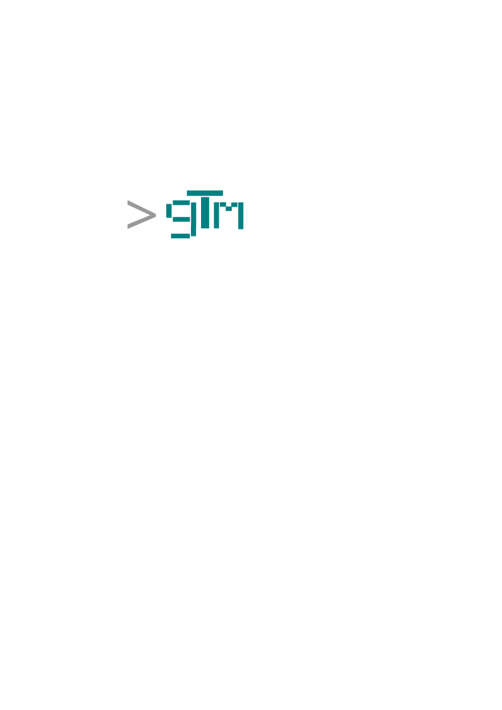
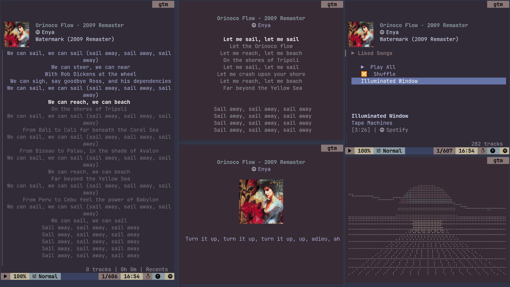
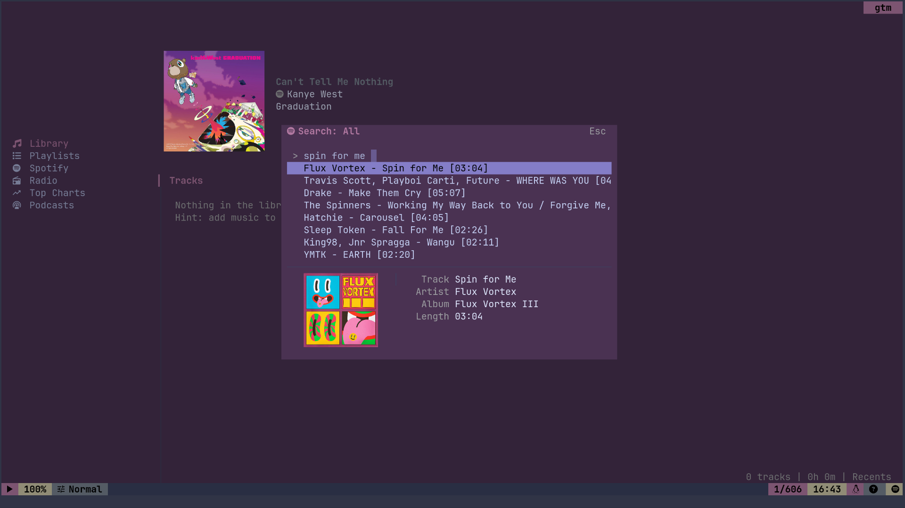
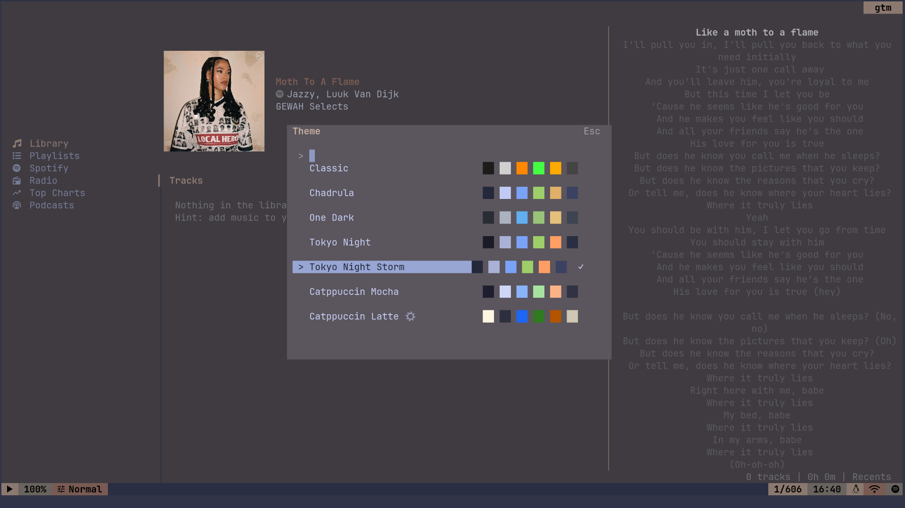

<!-- LOGO -->

# [`📻️ gtm(d)`](https://gtmd.dev)



<p align="center">
  <a href="https://gtmd.dev"></a>
  <br />
  A reimagined audio player built for terminal enthusiasts.
  <br />
  <a href="#features">Features</a>
  ·
  <a href="#download">Download</a>
  ·
  <a href="https://gtmd.dev/docs">Docs</a>
  ·
  <a href="CONTRIBUTING.md">Contributing</a>
  ·
  <a href="https://discord.gg/h5bKgkWBfT">Discord</a>
  ·
  <a href="#acknowledgements">Acknowledgements</a>
</p>

<p align="center">
  <a href="https://cli.masoko.net/tools/gtm/"></a>
  <a href="https://ratatui.rs/"></a>
  </p>

## Features

- **[Background playback](https://gtmd.dev/docs/daemon)**: reattach to the
  client from anywhere in the terminal
- **YouTube & Spotify**: search & download from
  [YouTube](https://gtmd.dev/docs/youtube) and sync
  [Spotify](https://gtmd.dev/docs/spotify).
- **Offline playback**: Resolve Spotify tracks via yt-dlp for
  [downloading](https://gtmd.dev/docs/youtube).
- **[Internet radio](https://gtmd.dev/docs/radio)**: browse the Radio Browser
  directory and stream any station
- **[Podcasts](https://gtmd.dev/docs/podcasts)**: subscribe to RSS/Atom feeds
  and play episodes in order
- **[Top charts](https://gtmd.dev/docs/library)**: Spotify, Apple and community
  charts, browsable as a tree
- **[Crossfade](https://gtmd.dev/docs/crossfade)**: gapless-ish transitions with
  a configurable duration.
- **[Lyrics](https://gtmd.dev/docs/lyrics)**: automatic fetch from LRCLIB
  (default provider)
- **[Metadata sync](https://gtmd.dev/docs/metadata-sources)**: backfill missing
  tags, cover art, and lyrics for local files
- **[Last.fm](https://gtmd.dev/docs/metadata-sources)**: scrobbling, love and
  now-playing
- **[Equalizer](https://gtmd.dev/docs/audio)**: 16 presets
- **[Visualizer](https://gtmd.dev/docs/audio)**: 12 spectrum presets
- **[Command palette](https://gtmd.dev/docs/tui)**: fuzzy-finder over every TUI
  action
- **[Extensions](https://gtmd.dev/docs/configuration)**: toggle optional
  surfaces per session
- **[Playlist management](https://gtmd.dev/docs/library)**: Import/export `m3u8`
  playlists
- **[Sleep timer](https://gtmd.dev/docs/playback)**
- **[Cover art support](https://gtmd.dev/docs/cover-art)**: rendered inline via
  the kitty/terminal image protocol
- **[Zero configuration](https://gtmd.dev/docs/configuration)**: sane defaults,
  fully customizable via TOML
- **[Progress styles](https://gtmd.dev/docs/theming)**: four indicators for the
  playback position
- **[Theming](https://gtmd.dev/docs/theming)**: accent colors extracted from the
  current track cover (reactive theming), transparent mode and 16 built-in
  themes
- **[MPRIS](https://gtmd.dev/docs/mpris)**: media player controls via D-Bus

## Download

```bash
# stable (latest)
curl -fsSL https://gtmd.dev/install.sh | bash
```

For `nightly` builds (released on every push to `dev`):

```bash
# nightly
curl -fsSL https://gtmd.dev/install.sh | bash -s -- --nightly
```

Or grab an archive
[releases page](https://github.com/prjctimg/gtm/releases/latest), extract it,
and run the `./install.sh` in its directory

See [CONTRIBUTING](./CONTRIBUTING.md#build-from-source) for more installation
routes.

### Install via AUR

`gtm` is available in the AUR as `gtm-player` and `gtm-player-bin` (binaries, no
compilation step):

```bash
# yay
yay -S gtm-player

# paru
paru -S gtm-player
```

You can also install the binary directly instead of the above:

```bash
# yay
yay -S gtm-player-bin

# paru
paru -S gtm-player-bin
```

## Documentation

- [gtmd.dev](https://gtmd.dev)

### Manpages

- [gtm(1)](docs/man/gtm.1.md)
- [gtmd(1)](docs/man/gtmd.1.md)
- [gtmd-ipc(1)](docs/man/gtmd-ipc.1.md)

## Contributing

See [the contributing guide](CONTRIBUTING.md) and
[the Code of Conduct](CODE_OF_CONDUCT.md) first.

## Screenshots

**multiple clients opened in different panes** 

**spotify search** 

**theme picker** 

**about** 

## Acknowledgements

This project wouldn't be possible without the amazing open source community!

- [color-thief](https://crates.io/crates/color-thief)
- [rustfft](https://crates.io/crates/rustfft)
- [ratatui](https://ratatui.rs),
  [ratatui-image](https://crates.io/crates/ratatui-image)
- [symphonia](https://crates.io/crates/symphonia),
  [fundsp](https://crates.io/crates/fundsp), and
  [rodio](https://crates.io/crates/rodio)
- [innertube-rs](https://crates.io/crates/innertube-rs)
- [yt-dlp](https://github.com/yt-dlp/yt-dlp)
- [LRCLIB](https://lrclib.net)
- [Myx](https://github.com/HaseebKhalid1507/Myx)
- [spotify-player](https://github.com/aome510/spotify-player)

<a href="https://www.star-history.com/?repos=prjctimg%2Fgtm&amp;type=date&amp;legend=top-left">
 <picture>
   <source media="(prefers-color-scheme: dark)" srcset="https://api.star-history.com/chart?repos=prjctimg/gtm&amp;type=date&amp;theme=auto&amp;legend=top-left" />
   <source media="(prefers-color-scheme: light)" srcset="https://api.star-history.com/chart?repos=prjctimg/gtm&amp;type=date&amp;theme=auto&amp;legend=top-left" />
   
 </picture>
</a>

## Contributors

<!-- CONTRIBUTORS -->
<p align="left">
  <a href="https://github.com/iseeheaven"></a> <a href="https://github.com/prjctimg"></a> <a href="https://github.com/skchr"></a> <a href="https://github.com/vaishnav-sabari-girish"></a>
</p>
<!-- /CONTRIBUTORS -->

(c) 2026, [prjctimg](https://prjctimg.me)

Released under the GPL-3.0 license.
